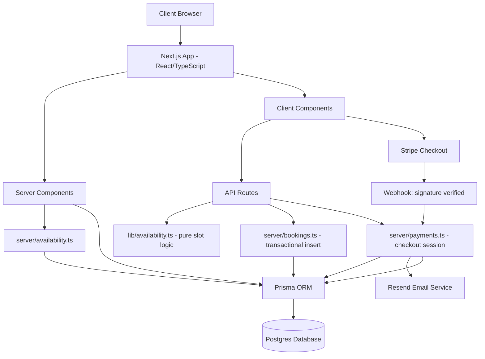

# Calyx

A booking SaaS for **freelance developers and consultants** to sell paid consultation and discovery calls — with a custom intake form so clients share project details upfront, before the call ever happens.


**Live demo:** [calyx.chrisliampas.dev](https://calyx.chrisliampas.dev) &nbsp;•&nbsp; **Demo video/GIF:** coming soon

> Running in Stripe test mode — use card `4242 4242 4242 4242` with any future expiry and CVC. No real payments are taken.

---

## Why I built this

Freelance developers and consultants who charge for their time have no clean way to both take payment and gather context before a call. Generic schedulers like Calendly handle the calendar part fine, but leave you starting every paid call cold — no idea what the client actually needs, and no guarantee they'll show up having paid. Calyx bundles the booking, the payment, and a custom intake form into one flow, so by the time the call starts you already know what the client wants to talk about.

## Status

v1 core flow is **live and working end to end**: a stranger can open a consultant's link, pick a slot, fill the intake form, pay, and receive a confirmation — while the consultant gets the booking with the intake answers. No manual steps anywhere.

See [Roadmap](#roadmap) for what is deliberately not built yet.

## Features

- 📅 **Availability & booking** — consultants define weekly availability rules; bookable slots are computed on demand, with timezone-correct display and database-level double-booking prevention
- 💳 **Payments** — Stripe Checkout, with bookings confirmed only by a signature-verified webhook
- 📋 **Custom intake form** — clients submit project scope, budget range and timeline at booking time, so the consultant walks in prepared
- 📧 **Email confirmations** — transactional emails to both client and consultant via Resend, sent from a verified domain
- ⚡ **Real UX states** — empty states, loading states, keyboard-navigable slot selection, and error handling throughout (not just the happy path)

## Engineering decisions

The parts of this project I'd actually want to talk through.

**Availability is rules, not rows.** A consultant's availability is stored as weekly rules (day of week + start/end minute). Bookable slots are calculated on demand rather than pre-generated — fewer rows, no background job creating future slots, and changing your hours takes effect immediately.

**All times stored in UTC; conversion happens at the edges.** Availability rules are *wall-clock* intentions ("09:00 on Mondays"); bookings are *instants*. Converting between them uses Luxon's IANA timezone database, building each time from its calendar fields rather than adding minutes to midnight — which is what makes it survive DST transitions. A 09:00 Athens slot is `06:00Z` in summer and `07:00Z` in winter, and both are correct.

**One definition of "valid slot", used twice.** Rather than writing a second validator for submitted bookings, `isValidSlotStart` asks the slot generator for a 2-millisecond window and checks membership. Display and server-side validation can't drift apart, and any future rule (buffers, per-date overrides) is inherited by validation for free.

**Double-booking is prevented with `Serializable` isolation, not just a transaction.** A transaction gives atomicity, not mutual exclusion — at Postgres's default `READ COMMITTED`, two concurrent requests can both pass an overlap check and both insert. Serializable makes Postgres detect the conflicting pair and abort one, which arrives as Prisma error `P2034` and is returned to the client as a clean `409`.

**A booking is confirmed by webhook, never by redirect.** The browser redirect after Stripe Checkout is a UX convenience — it can be skipped, spoofed, or never happen. The success page reads and reports the booking's actual status; only a signature-verified `checkout.session.completed` event may set `CONFIRMED`.

**Webhook handling is idempotent by construction.** Status transitions use conditional updates (`where: { status: "PENDING" }`), so a redelivered event matches zero rows and changes nothing. The same `count === 0` check prevents duplicate confirmation emails, and means a cancelled booking can't be resurrected by a replay.

**Checkout accepts cards only, pinned in code.** Delayed-notification methods (SEPA Direct Debit, bank transfers and similar) complete Checkout as `unpaid` and settle days later through a separate event the webhook doesn't handle. An explicit `allowed_payment_method_types: ["card"]` keeps that assumption in version control, so enabling a payment method in the Stripe dashboard can't silently strand bookings in `PENDING`. Apple Pay and Google Pay still work, as card wallets.

**A failed checkout releases its slot.** Bookings are created before the Stripe session, so if Stripe refuses to create one, the booking is cancelled immediately rather than holding the slot forever. If the session *was* created, the booking is deliberately left alone — the client could still pay — and the session's 30-minute expiry webhook releases it instead.

**Price is read from the database, never from the request.** The client posts a slot and their details — never an amount. `priceAtBooking` is snapshotted onto the booking so historical records stay correct if the consultant later changes their rate.

**Side effects don't undo committed state.** Emails are sent after the confirmation transaction commits, with `Promise.allSettled` and errors logged rather than thrown. A failing email must not produce a 500, because Stripe would retry and the retry would skip the send entirely.

**Rate limiting runs before anything else, and fails open.** `/api/bookings` is public and every accepted request holds a slot, so it allows 5 attempts per IP per 10-minute sliding window, checked before the body is even parsed — the cheapest rejection first. Counters live in Upstash Redis, because in-memory counters are meaningless on serverless, where each request may hit a different instance. If Redis is unreachable the request is allowed and the failure logged: the limiter is abuse mitigation, not correctness, and an outage shouldn't stop real clients booking. Double-booking and pricing are still enforced by the database either way.

**Client-supplied text is escaped before it reaches an email template.** Validation caps length and checks format; it never makes content safe to render as HTML.

## Tech stack

| Layer | Choice |
|---|---|
| Language | TypeScript (full stack) |
| Frontend | React, Next.js 14 (App Router) |
| Styling | Tailwind CSS |
| Database | PostgreSQL (Neon) + Prisma ORM |
| Validation | Zod (shared client/server schemas) |
| Dates & timezones | Luxon |
| Payments | Stripe (Checkout + Webhooks) |
| Email | Resend |
| Rate limiting | Upstash Redis |
| Hosting | Vercel |

## Architecture



Three layers, deliberately separated: `lib/` holds pure logic with no database (unit-testable in isolation), `server/` holds data access, and route handlers hold only HTTP concerns — parsing, validation, status codes.

## Running locally

**Prerequisites:** Node 18+, a PostgreSQL database (Neon's free tier works), a Stripe account in test mode, a Resend account.

```bash
git clone https://github.com/Chriliab/Calyx.git
cd Calyx
npm install
```

Create a `.env` in the project root:

```
DATABASE_URL="postgresql://..."
STRIPE_SECRET_KEY="sk_test_..."
STRIPE_WEBHOOK_SECRET="whsec_..."
NEXT_PUBLIC_APP_URL="http://localhost:3000"
RESEND_API_KEY="re_..."
EMAIL_FROM="Calyx <onboarding@resend.dev>"
UPSTASH_REDIS_REST_URL="https://..."
UPSTASH_REDIS_REST_TOKEN="..."
```

Push the schema and start the dev server:

```bash
npx prisma db push
npm run dev
```

**For webhooks to work locally**, Stripe needs a tunnel to your machine. In a second terminal:

```bash
stripe listen --events checkout.session.completed,checkout.session.expired \
  --forward-to localhost:3000/api/webhooks/stripe
```

That prints a `whsec_...` signing secret — put it in `STRIPE_WEBHOOK_SECRET`. It is **not** the same secret as a production endpoint's; each endpoint has its own. Without the listener running, payments succeed on Stripe's side and bookings stay `PENDING`, which is the system correctly refusing to trust the browser.

You'll also need a consultant, a session type and some availability rules in the database — Prisma Studio (`npx prisma studio`) or a few inserts will do it.

## Known issues & technical debt

**Next.js pinned to v14.** Next 15/16 currently pull in Tailwind v4, whose native Windows binary (`@tailwindcss/oxide-win32-x64-msvc`) fails to install reliably in this environment — a known npm optional-dependency bug. Pinning to Next 14 with Tailwind v3 was the pragmatic call to keep the build moving.

**Consequence:** `npm audit` reports vulnerabilities in the Next 14 dependency tree, including a critical RCE advisory that applies to self-hosted Windows servers. Calyx deploys to Vercel (Linux), so the exposure is limited, but this is real technical debt.

**Single consultant.** v1 enforces one session type per consultant in application logic, and the consultant record is seeded rather than self-service.

## Roadmap

- **Consultant auth (Clerk)** and self-service onboarding — the schema already mirrors Clerk user IDs
- **Consultant dashboard** — upcoming bookings with intake answers, ownership-checked on every read
- Client-side timezone selection (v1 displays the consultant's timezone, clearly labelled)
- Multiple session types per consultant
- Per-date availability overrides, holidays, buffers between sessions
- Calendar sync (Google, Outlook)
- Custom intake form builder
- Subscription billing for consultants — the payment layer is already separated from booking logic to accommodate it
